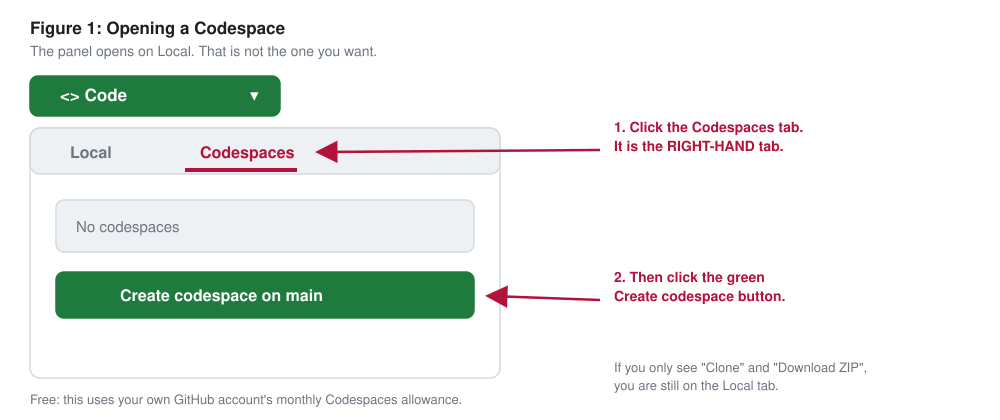
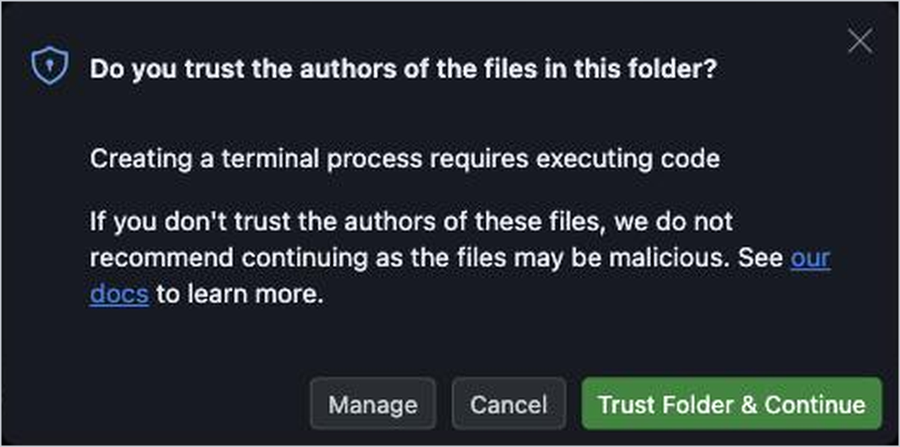
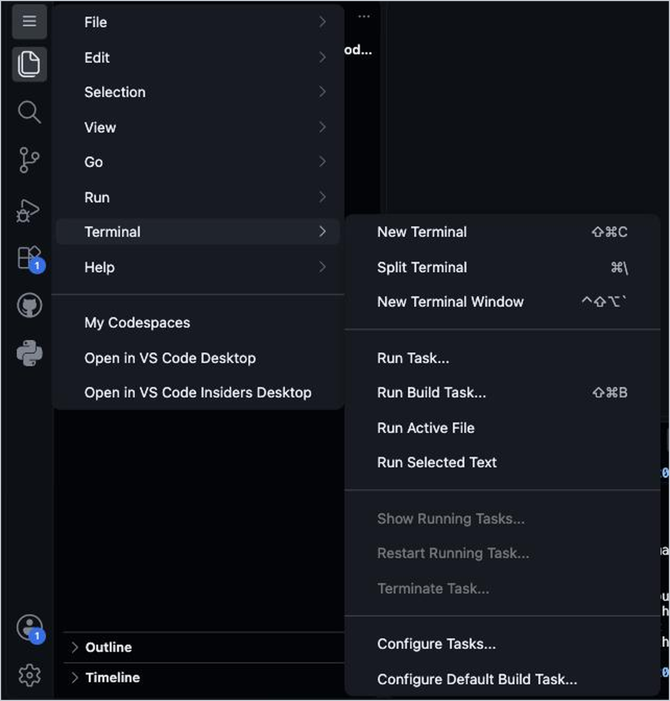

# Building with LLMs: a one-day hands-on workshop

What an AI agent can do for a researcher, shown one capability at a time, on your own files or on a real public example. Oklahoma State University, Digital Scholarship Center, Edmon Low Library, Wednesday, November 11, 2026. Instructor: John Hassell, OU Polytechnic Institute.

The day is a tour of seven stops. At each one the agent works in a folder: it runs code on your files, leaves files you can open, and leaves a program that runs again next week. Every stop ends with something in your repository and the same checkpoint: show the file, explain one choice that mattered, and show one check you made yourself. By the close you leave with:

1. A small tutorial website on something you teach, live and at a permanent address.
2. A script that rebuilds every figure and number of an analysis from the raw file, and an answer to a research question from your own papers: every value they report, with a quote and a page a program has confirmed, every searched paper's DOI checked, and the rows behind each part of the explanation.
3. One tool from your own week that runs on a new input with one command, and this repository, yours to keep, pointed at any model by changing two lines.

Nothing is installed on your laptop. Everything runs in a GitHub Codespace: VS Code in a browser tab, with a terminal, on a machine GitHub runs for you.

---

## Before the workshop: five steps, about ten minutes

You need a free GitHub account and a laptop with a current browser.

1. **Make your copy of this repository.** At the top of this page click the green **Use this template** button, then **Create a new repository**. Give it any name. It is yours.
2. **Open a Codespace.** On your new repository click the green **Code** button, the **Codespaces** tab, then **Create codespace on main**. The first one takes two or three minutes to build; you watch a log while it does.

   

3. **Click Trust Folder & Continue** when VS Code asks whether you trust the authors of the files in this folder. Until you click it, no terminal can start.

   

4. **Press Enter when the terminal asks for a key.** Setup starts by itself in the terminal at the bottom. You get a word for it on a card on the morning, so for now just press Enter. The terminal prints:

       Codespace ready; endpoint check pending.

   That line is the whole goal of the pre-work. If you only see a line ending in `$`, type `bash setup.sh` and press Enter.

5. **Optional: bring your own material.** Every stop works on a shipped public example if you bring nothing, but the day is better with your own. Keep these on your laptop; on the morning you drag them onto the `mine/` folder in the file tree and run `python upload_check.py`, which says whether each one is ready.

   - One small CSV from your work (a few thousand rows is plenty), with a line about what each column means and its units. If it lives in Excel, save a copy as CSV.
   - Two or three short research papers as PDFs you can select text in, not scans.
   - One chart from a paper you are reading, as a PNG or JPEG. A screenshot is fine.

   Whatever you upload travels from your laptop to your GitHub Codespace, and a stop that reads it sends its contents to the model service. So leave at home unpublished results you are not free to share, student records, and anything under an IRB protocol. `mine/` is never committed.

When you finish, stop the Codespace at <https://github.com/codespaces> (the **...** menu beside it). A stopped Codespace keeps your files and restarts in seconds. Stopping matters: the Codespace has four cores, and GitHub's free allowance is about 30 hours a month of running time at that size.

---

## On the morning

Open your Codespace, open a terminal if one is not already open, and type:

    bash setup.sh

Type the word on your card (letter case does not matter) and press Enter. Setup recognizes what you typed and connects to the right place: the card's word connects you to the room's model, and your own OpenRouter key (it starts with `sk-or-`) or NVIDIA key (`nvapi-`) works too. With your own OpenRouter key, setup offers the tested models in `00_setup/models.txt`; Enter picks NVIDIA Nemotron 3 Ultra. Its READY box also shows your site address, on the line that starts `Your site (files in site/):`. Setup then connects OpenClaw, a complete agent program, to the same model, opens Stop 1's page in the editor, and opens OpenClaw's chat in the terminal. Before you type there, finish Stop 0: click the + on the terminal panel for a second terminal and run

    python 00_setup/check.py

which prints the model the endpoint serves and a one-word reply. Stick the green note on the back of your laptop lid. If you brought files, drag them onto `mine/` and run `python upload_check.py` in the same terminal. Then Stop 1, back in the chat: ask for a small tutorial website on something you teach. It ends with your site's live address and its permanent address.

---

## The day

| Time | Stop | Folder | Start with |
|---|---|---|---|
| 8:30 | 0, everyone green | `00_setup/` | `python 00_setup/check.py`, then `python upload_check.py` |
| 9:00 | 1, an agent that builds: a website for your students | `00_website/` | `openclaw chat` |
| 9:35 | 2, your data, analyzed and reproducible, opening with a weak and a strong prompt | `02_data/` | `openclaw chat`, on the air-handler file |
| 10:45 | Break | | |
| 11:00 | 3, a research question answered from papers you can check, ending with the minute paper and your Stop 6 choice | `03_lit/` | `openclaw chat`: `Read 03_lit/question.md and do what it says.` |
| 12:15 | Lunch | | |
| 1:00 | 4, a chart back into data, after rerunning the morning's script from memory | `04_see/` | `python results/analysis.py`, then `python 04_see/see.py 04_see/charts/penguin_bars.png --extract` |
| 1:25 | 5, the agent repairs research code, on Cimarron if it is up | `05_repair/` | `openclaw chat`, on `05_repair/analysis.py` |
| 2:10 | Break | | |
| 2:25 | 6, build one thing from your week; first result and the transfer test at 3:15 | `06_build/` | one of three recipes in `06_build/README.md` |
| 4:00 | Show and tell: your tool on your pair's file, then nominations | | `bash gallery.sh`, optional |
| 4:25 | Close: one trace read as a loop, Cimarron and accounts, export for everyone | | `bash export.sh` |

Each stop's README is the lesson, laid out the same way every time: what you will be able to do, the idea, the steps, a checkpoint, extensions, what carries forward, and what to do if something goes wrong.

The room's model is NVIDIA Nemotron 3 Ultra (`nvidia/nemotron-3-ultra-550b-a55b`), reached through OpenRouter. Stop 4 reads images, so it uses NVIDIA Nemotron 3.5 Super VL, also on OpenRouter.

Everything the stops make goes into `results/`, which is never committed, because what is built from your files can hold your data. `bash export.sh` packs it into one zip to download; everyone does that at the close. Show and tell is in pairs, then by nomination: you show your pair your tool on their file, and volunteers nominate what they saw in their partner's work. To make something public afterwards, look at it first, then copy it into `site/share/`: it is public on your site at once, so put there only what could go on a conference slide. `bash gallery.sh` then posts a card linking to your site.

Behind? `bash catchup.sh s3` restores Stop 3's files so you can start there (`s2` to `s6`; your own versions are copied to `mine/` first). The first version of the day, six modules on prompting, structured output and the tool loop, is in `followon/old-modules/`, and `bash catchup.sh m1` to `m6` restores those.

---

## Three steps: a chat box, an agent in your folder, an agent on your campus cluster

A chat box answers from what you paste into it. An agent in your folder runs code on your files and leaves programs that run again: that is the day, on OpenRouter. An agent on your campus cluster does the same with the model running on OSU's Cimarron cluster instead of at a commercial provider.

If Cimarron is up, one command moves your Codespace there between stops, and one moves it back:

    bash 00_setup/switch_backend.sh cimarron
    bash 00_setup/switch_backend.sh openrouter

On Cimarron the model's work, reading your prompt and the file contents the agent sends it and writing the reply, happens on OSU hardware in Stillwater. Nothing else moves: your files still sit in your GitHub Codespace, so the rule about what to bring is the same on both. If Cimarron is up, Stop 5 runs on it; otherwise the instructor shows it from the front. Stop 4 stays on OpenRouter either way. Whether the Cimarron endpoint keeps running after November 11 is the HPCC's decision: ask them, and ask about an account for your own work, at <https://hpcc.okstate.edu>.

---

## What is in the repository

- `00_setup/` to `06_build/`: one folder per stop, each with its README and its helpers (`03_lit/lit.py`, `pages.py`, `check_values.py` and `pdfask.py`, `04_see/see.py` and `compare.py`, `05_repair/check_expected.py`, the three Stop 6 starters).
- `corpus/papers/`: three open-access papers for Stop 3. `corpus/SOURCES.md` says where every shipped dataset, paper and chart comes from, with its license.
- `upload_check.py`: checks what you put in `mine/`. `export.sh`: zips `results/`. `catchup.sh`: restores a stop's files.
- `llm.py`: `ask(prompt)` and `ask_json(prompt, Record)`, the interface the helpers use to call the model; it also records what each call cost.
- `agent.py`: the tool-calling loop, about forty lines: the loop OpenClaw runs, in its smallest form. At the close you read one of your own traces as this loop.
- `site/`: the website the agent builds in Stop 1. Never committed, and public at your site address while the Codespace runs, so put nothing private there. A copy is published to GitHub Pages automatically about a minute after it changes (`publish-site.sh` does it by hand). `site/share/` is where you put what you show the room.
- `gallery.sh`: optional; posts a card about your site and your tool to the public gallery after show and tell. You see the whole card before anything is posted.
- `convert.py`: turns a Word file in `mine/` into text.
- `03_table/`, `docs.py`, `records.py` and `corpus/doc_*.txt`: the first version of the day's evidence-table module and its sixteen invented documents, used by the modules in `followon/old-modules/`.
- `followon/`: for going further on your own, starting with `continue.md` for Thursday morning.

Every lab talks to one endpoint through two values in `.env`, `LLM_BASE_URL` and `LLM_API_KEY`. The backend is a configuration change, never a code change.

---

## Troubleshooting

| What you see | What to do |
|---|---|
| Only a line ending in `$`; setup never started | Type `bash setup.sh`, press Enter. |
| "That word is not the workshop word" | Type it again from the card. Letter case does not matter. |
| The key was not accepted | Copy the whole key again and type `bash setup.sh --reset-key`. |
| "The workshop endpoint is not set up yet" | If you pasted your own OpenRouter or NVIDIA key, copy the whole key again: its first characters tell setup where it goes. If you typed the word from the card, tell a helper. |
| Setup says it has already started in another terminal | Switch to the first terminal: the list at the right edge of the panel. |
| `No endpoint or key yet` when running a lab | `bash setup.sh`, then the word from the card. |
| `not reachable` from the check | Tell a helper. The instructor can switch the room to a different endpoint with one script. |
| HTTP 404 with your own NVIDIA key | The key is fine; NVIDIA opens only some models to a personal account. Use the model setup suggests, or ask help@build.nvidia.com to enable Public API Endpoints. |
| `upload_check.py` says `NOT READY` | It says why: an Excel file (save it as CSV), a scanned PDF, an iPhone photo (export it as JPEG). Give it three minutes, then use the shipped example it names and come back to yours in Stop 6. |
| Your site address shows "This site is empty for now" | The agent has not written `site/index.html` yet, or the page needs a refresh. `ls site` shows what is there. |
| The site address does not open, or the **Ports** tab shows port 8000 **Private** | Right-click the port 8000 row, **Port Visibility**, **Public**. If port 8000 is missing, type `bash .devcontainer/site-public.sh` and look again after ten seconds. |
| `python3 .devcontainer/site-check.py` fails | Tell the agent: `Run the site check and fix every problem.` A link that starts with `/` must become relative. |
| `cat ~/.osu-llm-workshop-pages-status` or `bash publish-site.sh` says `ONE STEP LEFT` | Once: the repository's **Settings**, **Pages**, **Deploy from a branch**, branch `gh-pages`, folder `/ (root)`, **Save**. The next change publishes, or run `bash publish-site.sh --yes`. |
| The site never reaches its permanent address, or `bash publish-site.sh` says the repository is private | A free GitHub account serves Pages only from a public repository. Make it public under **Settings**, or skip publishing and download the `site` folder instead. |
| OpenClaw is slow, or shows 429, 503 or a timeout | The whole room calls the same model. Wait a minute rather than typing the request again; if it gave up, type `Continue.` |
| The chat gets slow and forgets what it did | Type `/new`, then ask it to read the files it made and continue. |
| "Stop 4 needs OpenRouter" | `bash 00_setup/switch_backend.sh openrouter`, then run the command again. |
| You moved to Cimarron and OpenClaw still uses the old endpoint | A chat that was already open keeps it. Type `/exit`, then `openclaw chat`. |
| Stop 3 says it used a saved answer, or OpenAlex did not answer | The room shares OpenAlex's limit on free searches. `python 03_lit/lit.py --topics` lists topics that always work; try yours again later. |
| The agent edits a check, or a file it was told to use as it is | `git checkout <file>` puts it back. Then tell it not to change that file. |
| The terminal shrank when you opened a file | Click the square **Maximize Panel** button just left of the **X**. |
| No terminal at all | The **+** on the terminal panel. If the panel is gone: the **☰** menu at the top left, **Terminal**, **New Terminal**. |
| Anything else | Stop the Codespace at https://github.com/codespaces and start it again; your files are kept. Still stuck: Ctrl+Shift+P, then **Codespaces: Rebuild Container**, which also keeps your files. Delete a Codespace only after `bash export.sh` and downloading the zip, and copying anything you want from `mine/`, because deleting removes them. |

Helpers in the room work from `00_setup/troubleshooting.md`, which covers every stop.

---

## Credits and license

Original material written for this workshop. The Codespace machinery (the pinned container, the setup script that starts by itself, the key prompt) is adapted from [jhassell/asee9](https://github.com/jhassell/asee9), the 2026 ASEE Midwest workshop repository. The datasets, papers and charts the stops use are real and public; `corpus/SOURCES.md` gives each one's source and license. The sixteen documents in `corpus/` are invented: no real papers, authors or findings. Licensed under CC BY 4.0; see LICENSE, except the shipped datasets and papers, which keep their own licenses.

This workshop carries no certificate. Anyone who wants an NVIDIA credential in this area can take the NVIDIA-Certified Associate: Generative AI LLMs (NCA-GENL) exam separately.
