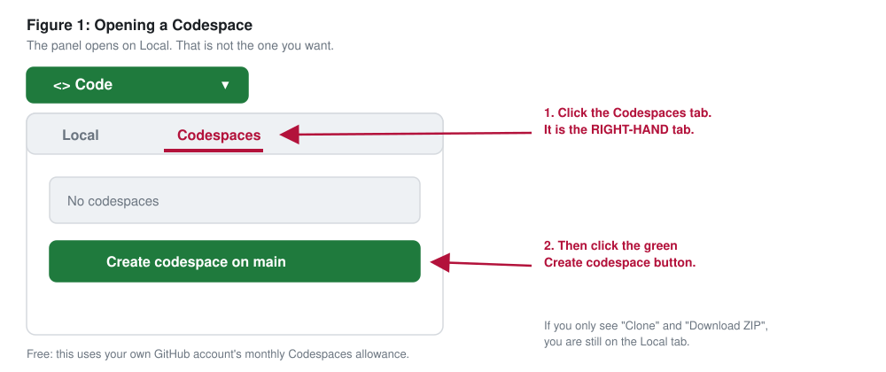
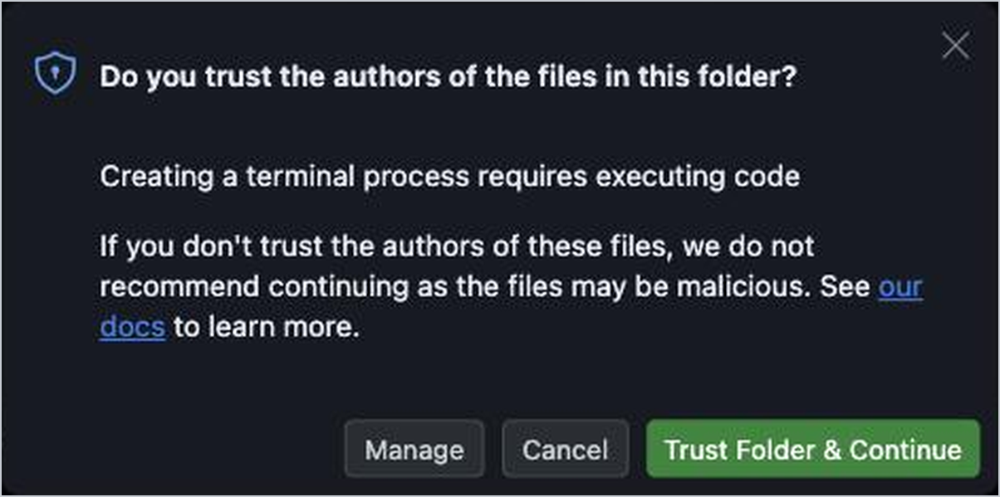
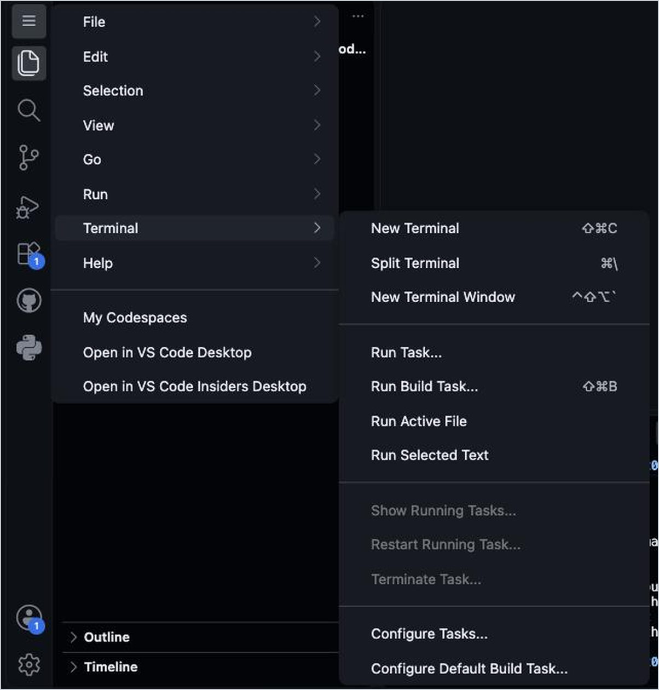

# Building with LLMs: a one-day hands-on workshop

What a language model can do for a researcher, and how to make it do that with a few lines of plain Python. Oklahoma State University, Digital Scholarship Center, Edmon Low Library, Wednesday, November 11, 2026. Instructor: John Hassell, OU Polytechnic Institute.

Everyone builds one program that grows all day: a document assistant over a corpus of short research documents. By the close you leave with three things:

1. A script that turns a folder of your own documents into a table, with each value tied to the sentence that supports it.
2. An agent that answers a research question from those documents with sources, and says so when they do not settle it.
3. This repository, yours to keep, pointed at any model by changing two lines, with your own tool already working in it.

Nothing is installed on your laptop. Everything runs in a GitHub Codespace: VS Code in a browser tab, with a terminal, on a machine GitHub runs for you.

---

## Before the workshop: five steps, about ten minutes

You need a free GitHub account and a laptop with a current browser.

1. **Make your copy of this repository.** At the top of this page click the green **Use this template** button, then **Create a new repository**. Give it any name. It is yours.
2. **Open a Codespace.** On your new repository click the green **Code** button, the **Codespaces** tab, then **Create codespace on main**. The first one takes two or three minutes to build; you watch a log while it does.

   

3. **Click Trust Folder & Continue** when VS Code asks whether you trust the authors of the files in this folder. Until you click it, no terminal can start.

   

4. **Press Enter when the terminal asks for a key.** Setup starts by itself in the terminal at the bottom. You will get the workshop key on the morning, so for now just press Enter. The terminal prints:

       Codespace ready; endpoint check pending.

   That line is the whole goal of the pre-work. If you only see a line ending in `$`, type `bash setup.sh` and press Enter.

5. **Optional: bring your own documents.** Five to ten short documents from your own work, PDF or Word or plain text, under about three pages each. Drag them onto the `mine/` folder in the file tree on the left, then in the terminal type `python convert.py`. They stay in your Codespace and are never committed. When a lab reads one, its text is sent to the workshop's model endpoint, exactly as the sample documents are, so bring only documents you are free to share with that service. The sample corpus is always enough for every lab, so this is optional.

Also write one sentence, anywhere you like: the question about your own documents you would most like a program to answer. You will use it after lunch.

When you finish, stop the Codespace at <https://github.com/codespaces> (the **...** menu beside it). A stopped Codespace keeps your files and restarts in seconds. Stopping matters: the Codespace has four cores, and GitHub's free allowance is about 30 hours a month of running time at that size.

---

## On the morning

Open your Codespace, open a terminal if one is not already open, and type:

    bash setup.sh

Paste the key the instructor gives you. Setup recognizes the kind of key and connects to the right place: the workshop key goes to the workshop endpoint, and your own OpenRouter key (it starts with `sk-or-`) or NVIDIA key (`nvapi-`) works too. Its READY box also shows your site address, on the line that starts `Your site (files in site/):`. Setup then asks:

    What next?
      1  The first exercise: have OpenClaw build a tutorial website   (just press Enter)
      2  Open OpenClaw now

Press Enter. Setup connects OpenClaw, a complete agent program, to the same model, opens the first exercise's page in the editor, and prints the next commands. The first is:

    python 00_setup/check.py

which prints the model the endpoint serves and a one-word reply. Turn your card green. Then the first exercise: in `openclaw chat`, the agent builds a small tutorial website on something you teach, served live from your Codespace, and you check what it wrote.

---

## The day

| Module | Folder | The one command |
|---|---|---|
| 0, everyone green | `00_setup/` | `python 00_setup/check.py` |
| The first exercise, a website for your students | `00_website/` | `openclaw chat` |
| 1, what the model can do | `01_tour/` | `python 01_tour/starter.py` |
| 2, getting it to do what you mean | `02_prompts/` | `python 02_prompts/starter.py` |
| 3, from documents to a table | `03_table/` | `python 03_table/starter.py`, then `python 03_table/run_folder.py`, then `python 03_table/audit.py 3 7 12` |
| 4, giving the model a tool | `04_tool/` | `python 04_tool/starter.py` |
| 5, an agent on your question | `05_agent/` | `python 05_agent/starter.py` |
| 6, your own tool | `06_project/` | `python 06_project/csv_tool.py` then `python 06_project/starter.py` |

Each folder's README is a complete lesson, laid out the same way every time: what you will be able to do, the idea, a prediction, the steps, a checkpoint, exercises, what carries forward, and what to do if something goes wrong. Behind? `bash catchup.sh m4` restores Module 4's files and the saved table so you can start there.

The shared code, all supplied and short:

- `llm.py`: `ask(prompt)` and `ask_json(prompt, Record)`. The whole interface.
- `records.py`: the record every document becomes. You change two marked lines.
- `agent.py`: the tool-calling loop, about forty lines. Read, not written.
- `docs.py`: reads documents. `convert.py`: turns your PDFs and Word files into text.
- `corpus/`: sixteen invented research documents in chemistry, genomics and life sciences, and engineering, and the saved table they produce.
- `site/`: the website the agent builds in the first exercise. Never committed, and public at your site address while the Codespace runs, so put nothing private there. `publish-site.sh` puts a copy on GitHub Pages, when you decide to.
- `followon/`: for going further on your own, starting with `continue.md` for Thursday morning.

Every lab talks to one endpoint through two values in `.env`, `LLM_BASE_URL` and `LLM_API_KEY`. The backend is a configuration change, never a code change.

---

## Troubleshooting

| What you see | What to do |
|---|---|
| Only a line ending in `$`; setup never started | Type `bash setup.sh`, press Enter. |
| The key was not accepted | Copy the whole key again and type `bash setup.sh --reset-key`. |
| "The workshop endpoint is not set up yet" | If you pasted your own OpenRouter or NVIDIA key, copy the whole key again: its first characters tell setup where it goes. If you pasted the key from the card, tell a helper. |
| Setup says it is already running in another terminal | Switch to the first terminal: the list at the right edge of the panel. |
| `No endpoint or key yet` when running a lab | `bash setup.sh`, paste the key. |
| `not reachable` from the check | Tell a helper. The instructor can switch the room to a different endpoint with one script. |
| HTTP 404 with your own NVIDIA key | The key is fine; NVIDIA opens only some models to a personal account. Use the model setup suggests, or ask help@build.nvidia.com to enable Public API Endpoints. |
| Your site address shows "This site is empty for now" | The agent has not written `site/index.html` yet, or the page needs a refresh. `ls site` shows what is there. |
| The site address does not open, or the **Ports** tab shows port 8000 **Private** | Right-click the port 8000 row, **Port Visibility**, **Public**. If port 8000 is missing, type `bash .devcontainer/site-public.sh` and look again after ten seconds. |
| `python3 .devcontainer/site-check.py` fails | Tell the agent: `Run the site check and fix every problem.` A link that starts with `/` must become relative. |
| `bash publish-site.sh` ends with `ONE STEP LEFT.` | Once: the repository's **Settings**, **Pages**, **Deploy from a branch**, branch `gh-pages`, folder `/ (root)`, **Save**. Then run it again. |
| `bash publish-site.sh` says the repository is private | A free GitHub account serves Pages only from a public repository. Make it public under **Settings**, or skip publishing and download the `site` folder instead. |
| A lab hangs on one document | Press Ctrl+C and run it again. The folder script already tries each document twice and keeps a row marked as an error rather than stopping; `run_folder.py --saved` copies a finished table. |
| The terminal shrank when you opened a file | Click the square **Maximize Panel** button just left of the **X**. |
| No terminal at all | The **+** on the terminal panel. If the panel is gone: the **☰** menu at the top left, **Terminal**, **New Terminal**. |
| Anything else | Stop the Codespace at https://github.com/codespaces and start it again; your files are kept. Still stuck: Ctrl+Shift+P, then **Codespaces: Rebuild Container**, which also keeps your files. Delete a Codespace only after copying anything you want from `mine/` and the labs, because deleting removes it. |

---

## Credits and license

Original material written for this workshop. The Codespace machinery (the pinned container, the setup script that starts by itself, the hidden key prompt) is adapted from [jhassell/asee9](https://github.com/jhassell/asee9), the 2026 ASEE Midwest workshop repository. The corpus is invented: no real papers, authors or findings. Licensed under CC BY 4.0; see LICENSE.

This workshop carries no certificate. Anyone who wants an NVIDIA credential in this area can take the NVIDIA-Certified Associate: Generative AI LLMs (NCA-GENL) exam separately.
